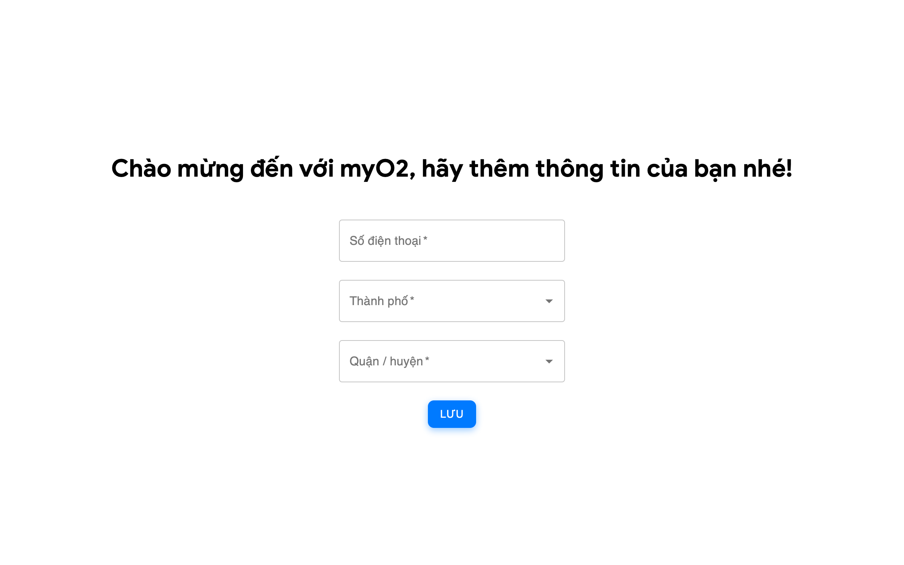
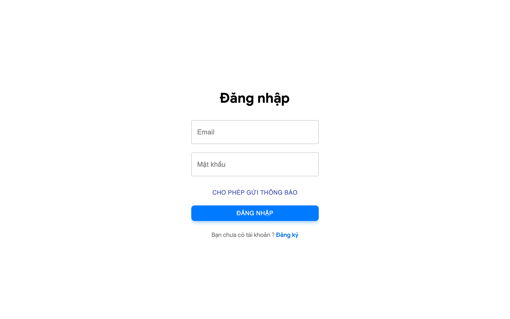
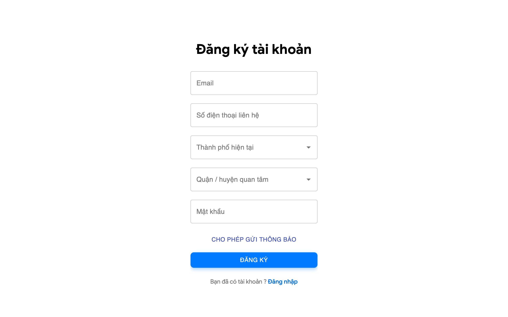
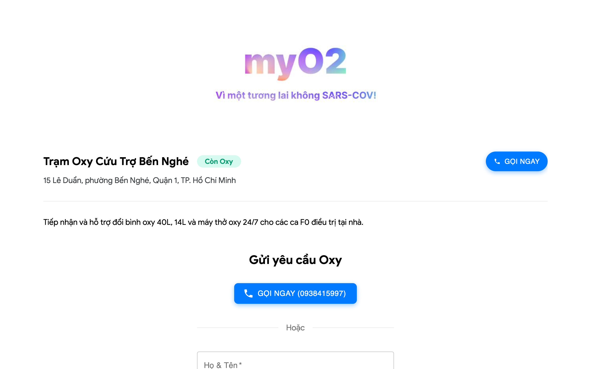
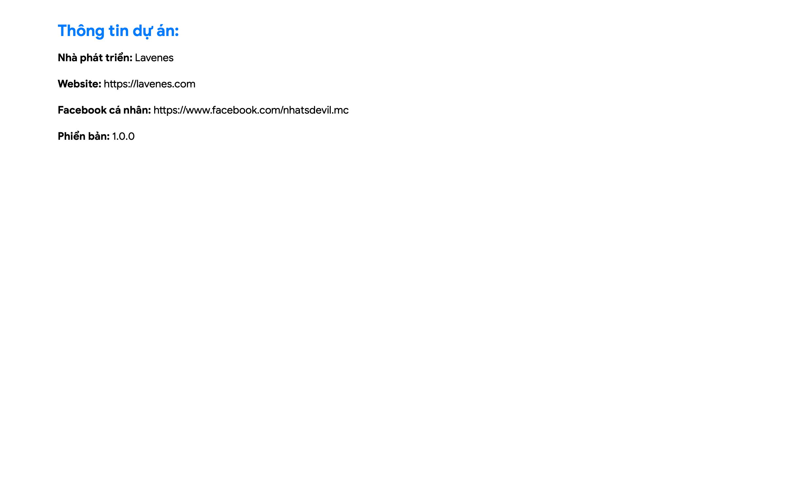

# myO2 — Community Emergency Oxygen Assistance Network

> [!NOTE]
> **Project Audit & Release Timeline**
> - **Initial Release Date**: August 29, 2021 (`29/08/2021`) — Built and deployed during the peak COVID-19 pandemic relief in Ho Chi Minh City, Vietnam.
> - **Codebase Audit & Modernization**: October 29, 2026 (`29/10/2026`) — Audited for Node 18+ runtime, decoupled Firebase configurations into environment variables, modernized Sass, integrated automated Cloudflare Pages CI/CD pipeline, and refreshed project documentation and previews.


**myO2** (also known as *My Oxy*) is a community-driven emergency oxygen cylinder locator and humanitarian assistance web application originally released on **August 29, 2021** during the peak of the COVID-19 pandemic in Ho Chi Minh City, Vietnam. On **October 29, 2026**, the codebase underwent a comprehensive audit and modernization to support modern Node.js environments and automated Cloudflare Pages continuous deployment.

When healthcare facilities and hospitals faced acute oxygen shortages during lockdowns, myO2 bridged the critical gap between patients with acute respiratory distress and grassroots volunteer groups, NGOs, and donors supplying oxygen cylinders across every district.

---

## 🌟 Key Features

- **District-by-District Oxygen Tracking**: Instant, localized inventory visibility of verified oxygen cylinders, regulators, and refill stations across all 24 districts of Ho Chi Minh City.
- **Emergency Hotline & Dispatch**: Quick-access one-tap calling and emergency request submission for high-risk patients.
- **Volunteer & Station Management**: Dedicated dashboard for depot managers and relief groups to add, update, and manage cylinder inventory, status, and contact details.
- **Real-Time Data Synchronization**: Backed by Firebase Realtime Database for immediate, live stock and availability updates without needing manual page reloads.
- **Push Notification Support**: Integrated Firebase Cloud Messaging (FCM) to broadcast urgent replenishment alerts and critical community requests.
- **Mobile-First Responsive Design**: Optimized with lightweight styling to load fast and perform smoothly on mobile networks under bandwidth constraints.

---

## 📸 Screenshots

| Onboarding & District Selection | Mobile Emergency View |
| :---: | :---: |
|  |  |

| Station Login | Volunteer Registration |
| :---: | :---: |
|  |  |

| Station Details & Emergency Request | Project Information & Credits |
| :---: | :---: |
|  |  |

---

## 🛠 Tech Stack

- **Frontend Core**: [React 17](https://reactjs.org/) (functional components, hooks)
- **UI & Components**: [Material-UI (MUI v4)](https://v4.mui.com/), `@material-ui/lab`, [React Icons](https://react-icons.github.io/react-icons/)
- **Routing**: [React Router](https://reactrouter.com/) (using `HashRouter` for zero-configuration static hosting and direct client routing)
- **Styling**: Sass / SCSS with modular variables, responsive mixins, and typography tokens
- **Realtime Database & Backend**: [Firebase](https://firebase.google.com/) (Realtime Database, Authentication, Cloud Messaging)
- **CI/CD & Hosting**: [Cloudflare Pages](https://pages.cloudflare.com/) via [GitHub Actions](https://github.com/features/actions) with [Cloudflare Wrangler Action](https://github.com/cloudflare/wrangler-action)

---

## 📋 Requirements

- **Node.js**: `16.x` or `18.x` (recommended)
- **Package Manager**: `npm` (v7+) or `yarn`

---

## 🚀 Setup & Local Development

### 1. Clone the repository

```bash
git clone git@github.com:nhatnice/myO2.git
cd myO2
```

### 2. Install dependencies

```bash
npm install --legacy-peer-deps
```

> **Note**: Due to peer dependencies between React 17 and Material-UI v4, use the `--legacy-peer-deps` flag when installing with modern npm versions.

### 3. Environment configuration

Copy `.env.example` to `.env` or set the environment variables in your build environment:

```bash
cp .env.example .env
```

| Variable Name | Description | Example / Default |
| :--- | :--- | :--- |
| `SKIP_PREFLIGHT_CHECK` | Bypass CRA dependency tree preflight check | `true` |
| `REACT_APP_FIREBASE_API_KEY` | Firebase Web API Key | `AIzaSyAGLoe...` |
| `REACT_APP_FIREBASE_AUTH_DOMAIN` | Firebase Auth Domain | `myo2-56c74.firebaseapp.com` |
| `REACT_APP_FIREBASE_PROJECT_ID` | Firebase Project ID | `myo2-56c74` |
| `REACT_APP_FIREBASE_STORAGE_BUCKET` | Firebase Storage Bucket | `myo2-56c74.appspot.com` |
| `REACT_APP_FIREBASE_MESSAGING_SENDER_ID` | FCM Messaging Sender ID | `930773898003` |
| `REACT_APP_FIREBASE_APP_ID` | Firebase Web App ID | `1:930773898003:web:...` |
| `REACT_APP_FIREBASE_MEASUREMENT_ID` | Google Analytics Measurement ID | `G-KY9TKCQG6K` |
| `REACT_APP_FIREBASE_DATABASE_URL` | *(Optional)* Custom Realtime Database URL | `https://myo2-56c74-default-rtdb.firebaseio.com` |

### 4. Run the development server

```bash
npm start
```

Open [http://localhost:3000](http://localhost:3000) to view the application in your browser.

### 5. Build for production

```bash
npm run build
```

This generates an optimized production bundle in the `build/` directory ready for static hosting.

---

## ☁️ Cloudflare Pages Deployment

You can deploy myO2 directly to [Cloudflare Pages](https://pages.cloudflare.com/) using Cloudflare's native Git integration or via the Wrangler CLI.

### Cloudflare Pages Git Integration

1. Go to your **Cloudflare Dashboard** > **Compute (Workers & Pages)** > **Create application** > **Pages** > **Connect to Git**.
2. Select your `myO2` repository and configure the build settings:
   - **Framework preset**: `Create React App`
   - **Build command**: `npm run build`
   - **Build output directory**: `build`
3. In **Environment variables**, configure your Firebase credentials:
   - Add all `REACT_APP_FIREBASE_*` variables listed in the [Environment Variables](#environment-variables) section.
   - Add `SKIP_PREFLIGHT_CHECK=true`.
4. Click **Save and Deploy**. Cloudflare Pages will automatically trigger a build and deploy on every push to `main`.

### Manual Deployment via Wrangler

You can also deploy manually at any time using Wrangler:

```bash
# Build the project
npm run build

# Deploy to Cloudflare Pages
npx wrangler pages deploy build --project-name=myo2
```

---

## 📂 Project Structure

```text
myO2/
├── images/                   # App showcase screenshots
│   ├── home.png
│   ├── mobile-home.png
│   ├── welcome.png
│   ├── login.png
│   ├── signup.png
│   ├── station-detail.png
│   └── project-info.png
├── public/                   # Public static assets & index.html
├── src/
│   ├── components/           # Reusable UI components (HeaderBar, Card, LoadingScreen, etc.)
│   ├── Global/               # Firebase configuration, constants, and utility helpers
│   ├── styles/               # Global SCSS stylesheets, variables, mixins, and fonts
│   ├── views/                # Route views (Home, Welcome, Login, Signup, Management, etc.)
│   ├── App.js                # App entry point, routing table, and push notification listener
│   └── index.js              # React DOM render root (HashRouter)
├── .env.example              # Example environment variables template
├── package.json              # Project scripts & dependencies
└── README.md
```

---

## 👤 Author

**NHAT TRAN**
- GitHub: [@nhatnice](https://github.com/nhatnice)
- Portfolio: [nhattran.dev](https://nhattran.dev)

Built with ❤️ for the community during the COVID-19 pandemic relief efforts.
